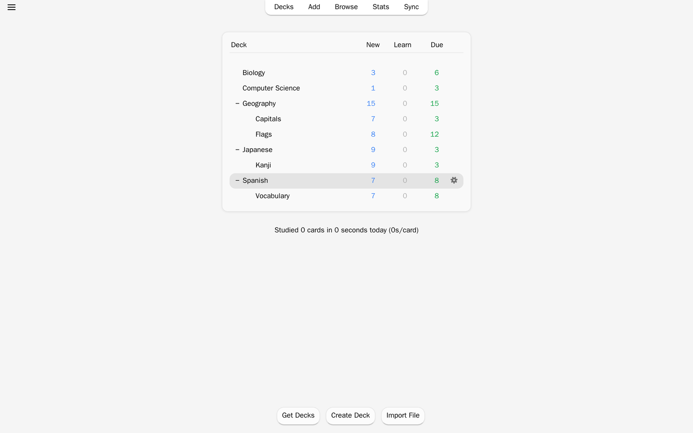
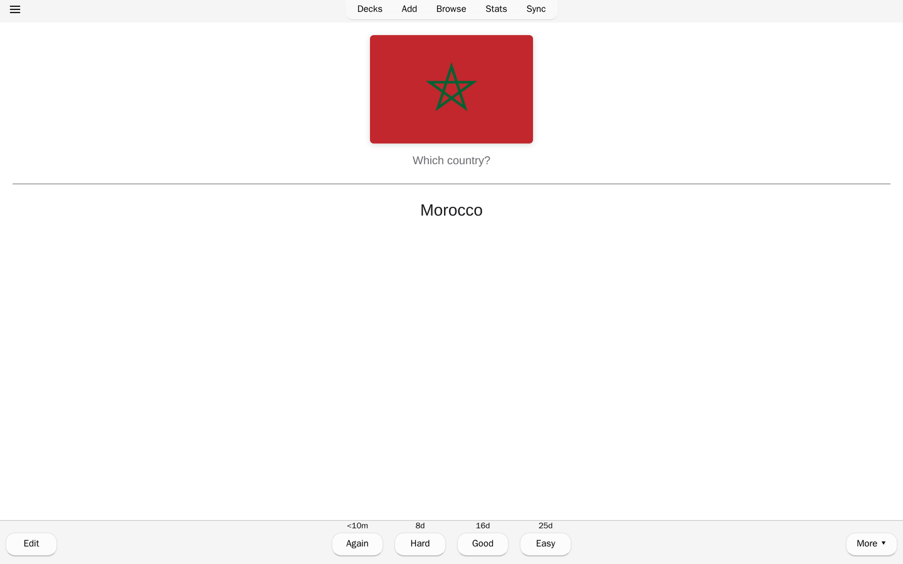
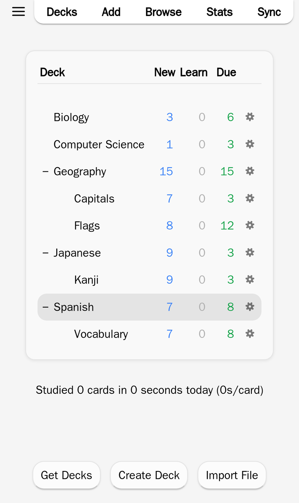
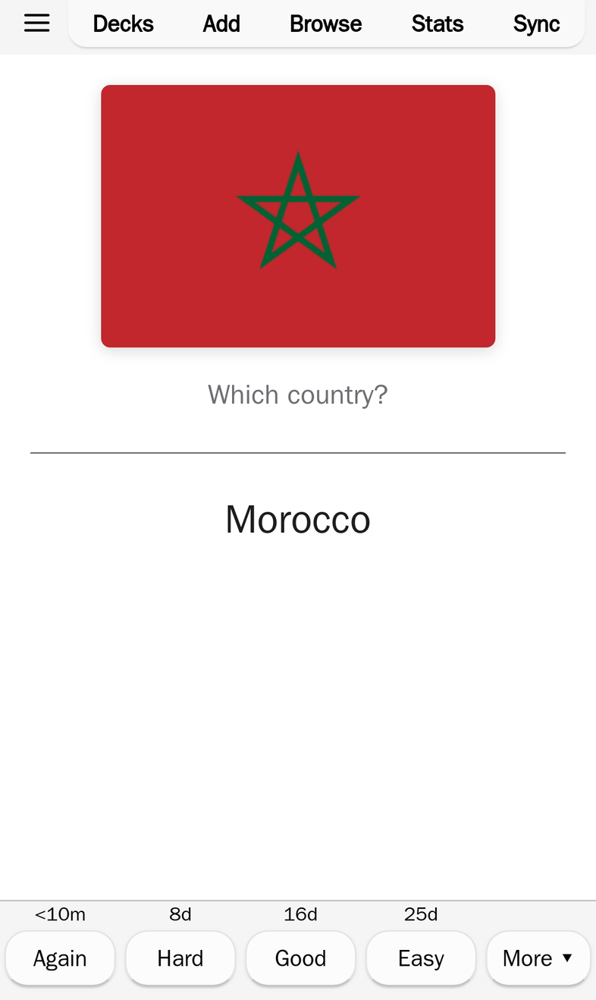
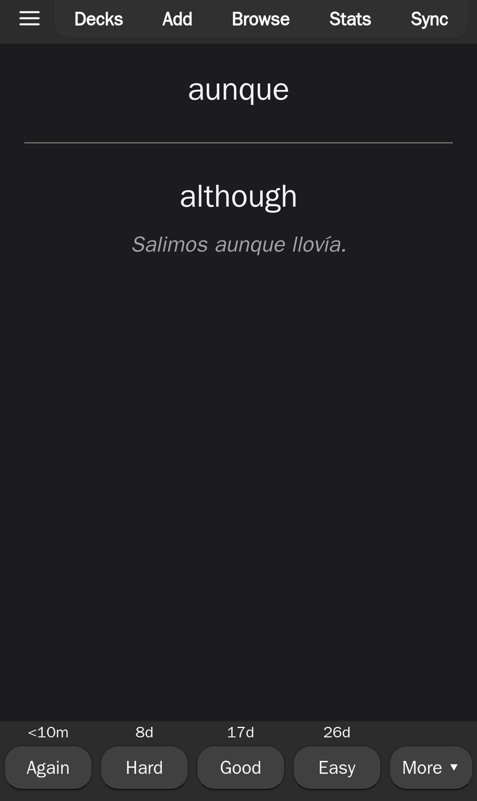
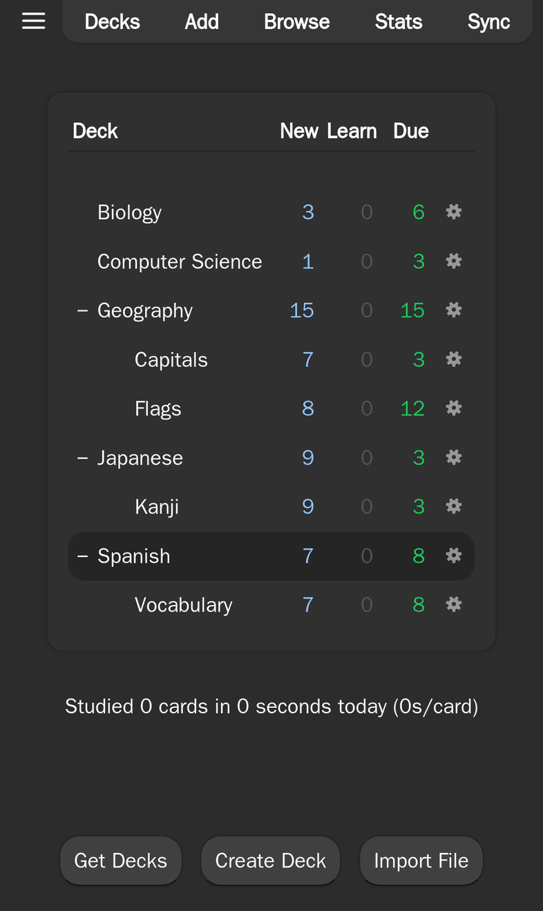

# Anki Anywhere

Desktop Anki in your browser. Study your AnkiWeb decks on any computer, phone
or tablet, with nothing to install. On an iPhone, that makes it a free way to
use Anki there.

**[Open Anki Anywhere](https://ankianywhere.vercel.app)** or
[deploy your own copy](#deploy-your-own) in a minute.

## What it is

- **Anki itself, not a clone.** Anki's Rust core is compiled to WebAssembly,
  and desktop's own screens (deck options, statistics, the editor, image
  occlusion and more) run unchanged. Scheduling, FSRS included, is the same
  code desktop runs.
- **Syncs with your AnkiWeb account**, so it works alongside Anki on your
  computer, AnkiDroid and AnkiMobile. Log in with the account you already
  have.
- **Your collection stays in your browser.** It is stored on your device,
  not on a server, and works offline once loaded. You can install it to your
  home screen like an app.
- **Add-ons**, rebuilt for the web: Review Heatmap, Advanced Browser, Speed
  Focus Mode and more, one click each under Tools > Add-ons.

## Privacy

AnkiWeb does not accept requests from other websites, so sync goes through
this site's server, which forwards each request to ankiweb.net and stores
nothing (the forwarding rules are in [`web/vercel.json`](web/vercel.json) and
[`web/api`](web/api)). Your login and every sync pass through it; your
password is sent once, and after that the app keeps only AnkiWeb's sync key,
in your browser. If you'd rather not trust
this site's server, [deploy your own](#deploy-your-own).

## Deploy your own

The button copies a small template ([`web/selfhost`](web/selfhost)) to your
GitHub and deploys it on a free Vercel account. It downloads the newest
prebuilt app, so nothing is compiled; redeploy in Vercel to update. Your copy
gets its own address and forwards sync through your own Vercel account.

One difference: this site shows cards from a second address, so scripts in
a shared deck's cards can't reach the app's data. Your copy has one address
and shows them the way desktop Anki does, so only study decks whose card
scripts you trust there.

## Good to know

- Only one tab can have your collection open at a time.
- Sync regularly. Browsers can clear a site's data when the device runs low
  on space, and Safari clears sites you haven't opened for 7 days unless you
  add them to your home screen.
- Desktop add-ons written in Python can't run in a browser; only the rebuilt
  ones above can.

Found a bug? [Open an issue](https://github.com/ytkimirti/ankianywhere/issues).

## How it's built

A fork of [ankitects/anki](https://github.com/ankitects/anki). The web app
lives in [`web/`](web), and [`web/README.md`](web/README.md) explains how it
fits together, how to build it and how plugins work. Everything else is
Anki's own code, kept in step with upstream.

Anki® is a registered trademark of Ankitects. Anki Anywhere is an unofficial
project, not affiliated with or endorsed by Ankitects. Like Anki, it is
licensed under the [GNU AGPL, version 3 or later](LICENSE).
